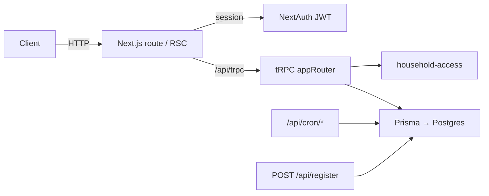

# Backend architecture

Strumf follows the [T3 Stack](https://create.t3.gg/) shape: Next.js App Router, tRPC, Prisma (Postgres), NextAuth (Auth.js v5).

## Request flow

## Module map

| Path | Responsibility |
| ----- | ---------------- |
| `src/server/api/root.ts` | Composes domain routers |
| `src/server/api/trpc.ts` | Context, `protectedProcedure`, active-user gate |
| `src/server/api/routers/*` | Zod input + authorization + Prisma |
| `src/server/lib/household-access.ts` | Authorization helpers (see ADR-0003) |
| `src/server/auth/` | NextAuth configuration |
| `src/server/lib/geoapify.ts` | Nearby provider (server-only egress) |
| `src/env.js` | Typed environment + production guardrails |

## Domain routers

Each router maps to vocabulary in `CONTEXT.md`: `household`, `baby`, `feeding`, `sleep`, `consultation`, `appointment`, `invite`, `nearby`, `dailySummary`.

## Adding an endpoint

1. Add Zod input on a `protectedProcedure` in the right router.
2. Call `requireBabyAccess` or the appropriate household helper.
3. Keep side effects (email, OpenAI, external HTTP) in `src/server/lib/*`.
4. Export the router from `root.ts`.

See [SECURITY.md](./SECURITY.md) for the reviewer checklist and production env rules.
